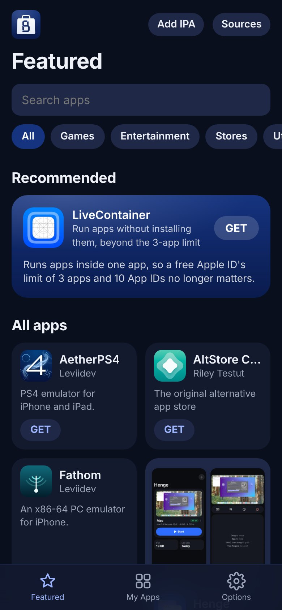
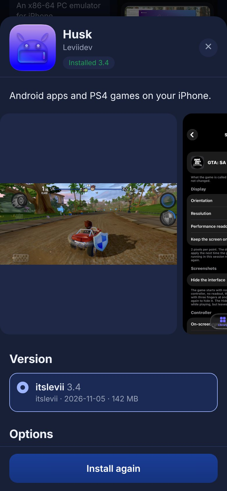

<p align="center"></p>

<h1 align="center">BariStore</h1>

<p align="center"><b>An app store for iPhone and iPad that needs no computer.</b><br>
Install, refresh and update sideloaded apps with a free Apple ID, on the device you hold.</p>

<p align="center"><a href="https://barismd.github.io/BariStore/">Website</a> ·
<a href="#install">Install</a> ·
<a href="https://github.com/barismd/BariStore/releases/latest">Latest release</a></p>

> [!NOTE]
> **BariStore now runs in [rootshell](https://apps.apple.com/app/id6755794662)**, a terminal app on the App Store,
> since Apple removed Open Minis from the App Store, and shows its store over rootshell. This is a test build
> (1.2.0-alpha): see [Install](#install).

<p align="center">
&nbsp;
&nbsp;

</p>

## Why BariStore

- **No computer, no second device.** Pairing, signing and installing all happen on the iPhone or iPad itself.
- **Developer Mode appears by itself.** If Settings does not list it, BariStore's pairing makes it appear; turn it on there.
- **Uses none of your 3 app slots.** It runs inside [rootshell](https://apps.apple.com/app/id6755794662), an App Store app, and shows its store over rootshell with the BariStore Shortcut (or in Safari).
- **Refresh in seconds.** A refresh renews the apps' profiles: nothing is downloaded, signed or uploaded again (apps signed with an older certificate are signed again).
- **JIT with one tap** for emulators and other JIT apps, right from BariStore.
- **Sources and updates.** App sources, any IPA from Files (a newer build of one updates it in place), one-tap updates, and per-app beta tracks (Off, nightly, alpha…).
- **Fast on the device.** One WebAssembly program of about 4 MB, run by the device's own engine.
- **Your App IDs under control.** See what uses each one, reuse the App IDs of deleted apps or type your own, keep or drop extensions, ask for Increased Memory Limit (later too: an update keeps it).
- **Your own app icons.** Pick any picture as an app's icon when you install it, or change it later.
- **Install into LiveContainer.** Send an app from Featured or an IPA from Files straight into LiveContainer; an app from one of your sources arrives with its source.
- **One Apple ID on your iPhone and your iPad.** Export the signing certificate on one and import it on the other: both sign with it, and neither stops the other's apps. BariStore never revokes a certificate without asking.
- **Works with the other tools.** SideStore, AltStore, LiveContainer + SideStore and StikDebug get the pairing file; the stores and LiveContainer get the signing certificate, so they can refresh themselves too.

## Install

### Before you install

Once, on the iPhone or iPad (iOS 27 or newer, a free Apple ID is enough):

1. **Get the apps:** [rootshell](https://apps.apple.com/app/id6755794662) (1.0.16-178 or newer) and
   [LocalDevVPN](https://apps.apple.com/app/id6755608044), from the App Store.
2. **Developer Mode on:** Settings › Privacy & Security › **Developer Mode** › On, then **Restart** and confirm with
   your passcode. Not listed there? It appears once BariStore starts pairing (setup's step 2): turn it on then, and
   pair after the restart. BariStore cannot pair or install with it off.
3. **LocalDevVPN:** on Wi-Fi, open LocalDevVPN and tap **Connect**.
4. **rootshell › Settings › General:**
   - **Location Diary Mode** on, **Mode: Auto During Active Sessions**; allow location access when iOS asks.
     rootshell then keeps BariStore running while you are in Settings or another app.
   - **Terminal Notifications** on; allow notifications when iOS asks: the pairing code also comes as one.
5. **Local Network:** when rootshell asks to find devices on your local network, tap **Allow** (pairing needs it).
   Turned it down? Settings › Privacy & Security › Local Network › rootshell on.

While BariStore runs, rootshell may show a Live Activity on the Lock Screen and in the Dynamic Island: that is
rootshell's own, and fine.

### Install

Paste this line into a rootshell tab:

```sh
sh -c "$(curl -fsSL https://raw.githubusercontent.com/barismd/BariStore/test/docs/install.sh)"
```

It downloads the newest BariStore into rootshell's folder, sets up the `baristore` command and opens the store; run
it again to update. (rootshell's `sh` runs a script given with `-c`, not one piped to it, so `curl … | sh` does not
work there.)

<a id="shortcut"></a>**Show the store over rootshell**, once:

1. In **rootshell › Profiles**, tap **+**, choose **Local Shell**, name it **BariStore** and set its **Startup
   Command** to `baristore page`.
2. In **Shortcuts**, tap **+**, name it **BariStore** and add **Open Connection Profile** (rootshell) with the
   BariStore profile, **Wait** 3 seconds, and **Show Web Page** with `http://127.0.0.1:46510/`.
3. Optional: add it to the Home Screen (the Shortcut's ⓘ › Add to Home Screen).

Run the Shortcut: BariStore starts in rootshell and its page shows over rootshell, which stays in front. Without it,
BariStore opens in Safari (rootshell › Settings › Terminal › **Open Links from Programs** lets it open Safari by
itself).

### Setup

The page walks you through it:

1. **Pair.** Settings › Privacy & Security › Developer Mode shows **Pair with BariStore** at the bottom: tap it,
   enter your passcode and type the code the page showed (it comes as a notification too). Then run the Shortcut
   again.
2. **Sign in** with your Apple ID. A code Apple sends can come to your Apple devices, or by text or call to any of the
   Apple ID's trusted numbers.
3. **Install** from Featured, or add any IPA.

Going to another app closes the page; BariStore goes on in its rootshell tab, and the Shortcut shows it again.
rootshell opens a tab for each run of a profile: when BariStore already runs, the new tab says so and can be closed. Typing `baristore` in rootshell starts it too. Updates come through
My Apps › Updates; Options › Log gives a report to share when something goes wrong (`baristore log` prints it in
another tab).

### Open Minis

BariStore 1.1 for Open Minis keeps working where Open Minis is installed. New versions come for rootshell only, while
Open Minis is not on the App Store.

## Safe by design

- **Your password never leaves your device** and is never saved: Apple's sign-in turns it into a one-time proof on the device.
- **There is no BariStore server.** No accounts, no analytics. BariStore talks only to Apple, an anisette server and the sources you add.
- **The anisette server never sees your Apple ID.** It only supplies device-identity data from a random identifier. Options › Anisette server lets you pick one or add your own.
- **Open source.** BariStore (MIT), rootshell (MIT) and the stores it offers (SideStore, LiveContainer, AltStore) are all open source.
- **Your keys stay with you.** The pairing record, session and signing key stay in rootshell's own folder, in `.baristore`, which the Files app does not show.

## Free Apple ID limits (Apple's)

Apps last **7 days** (Refresh all renews them), **3** apps at a time (BariStore does not count; LiveContainer runs
many apps inside one), **10** App IDs per 7 days (each app extension needs one; "Remove extensions" saves them).
A paid developer account has none of these limits: BariStore notices it.

## Build

One WebAssembly program for rootshell's WASI runtime: `cargo build --release --target wasm32-wasip1` makes
`target/wasm32-wasip1/release/baristore.wasm`. Tests: `cargo test`, and the same tests run by rootshell's own
runtime with `CARGO_TARGET_WASM32_WASIP1_RUNNER="node scripts/rootshell.mjs" cargo test --target wasm32-wasip1 --
--test-threads=1` (see the skips in `.github/workflows/release.yml`). How it works and what has been verified on a
device: [AGENTS.md](AGENTS.md).

## Licence

MIT, see [LICENSE](LICENSE). Third-party notices: [THIRD_PARTY_NOTICES.md](THIRD_PARTY_NOTICES.md).
Not affiliated with Apple.
