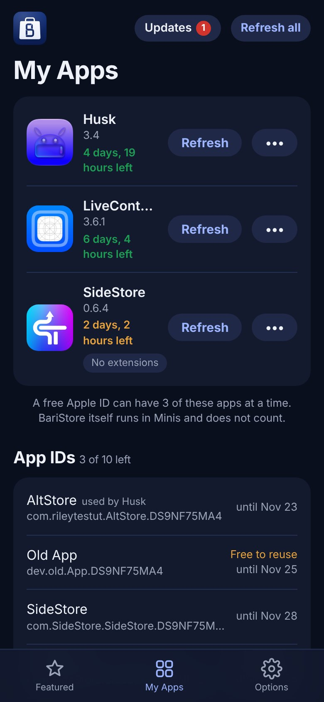

<p align="center"></p>

<h1 align="center">BariStore</h1>

<p align="center"><b>An app store for iPhone and iPad that needs no computer.</b><br>
Install, refresh and update sideloaded apps with a free Apple ID.</p>

> [!NOTE]
> Test build (1.2.0-alpha) for [rootshell](https://apps.apple.com/app/id6755794662). BariStore 1.1 keeps working
> where Open Minis is installed.

<p align="center">
&nbsp;
&nbsp;

</p>

## Install

**Before you install**, once (iOS 27 or newer):

1. Install [rootshell](https://apps.apple.com/app/id6755794662) and
   [LocalDevVPN](https://apps.apple.com/app/id6755608044) from the App Store.
2. **Developer Mode: On** (Settings › Privacy & Security › Developer Mode, then Restart). Not listed? It appears
   once BariStore starts pairing.
3. **LocalDevVPN:** on Wi-Fi, open it and tap **Connect**.
4. **rootshell › Settings › General:** Location Diary Mode **On**, Terminal Notifications **On**.
5. **rootshell › Settings › Terminal:** Open Links from Programs **On**.
6. **Local Network:** tap **Allow** when rootshell asks.

**Install:** paste this line into rootshell and press Return:

```sh
sh -c "$(curl -fsSL https://raw.githubusercontent.com/barismd/BariStore/test/docs/install.sh)"
```

It shows the same list; press Return and the store opens in Safari. Pairing and sign-in follow there.

## Use

| Command | |
|---|---|
| `baristore` | Opens the store in Safari. |
| `baristore update` | Updates BariStore. |
| `baristore log` | Prints the log, to share when something goes wrong. |

BariStore runs in its rootshell tab and quits after 3 minutes without use, or with **⏻** on its page.

- [BariStore on the Home Screen](docs/shortcut.md)
- [How it works](docs/how-it-works.md)

MIT licence ([LICENSE](LICENSE)). Not affiliated with Apple.
